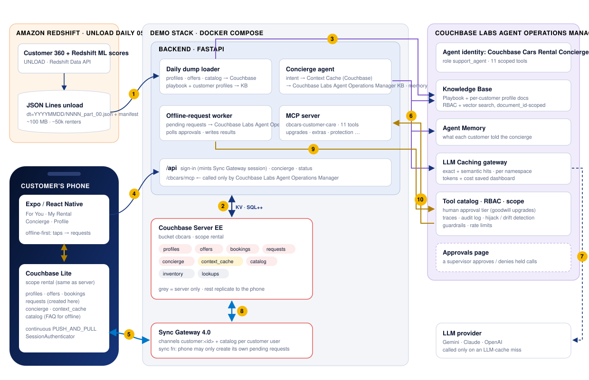
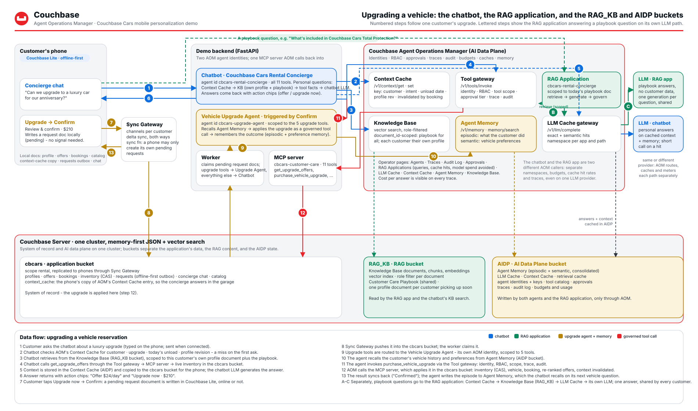
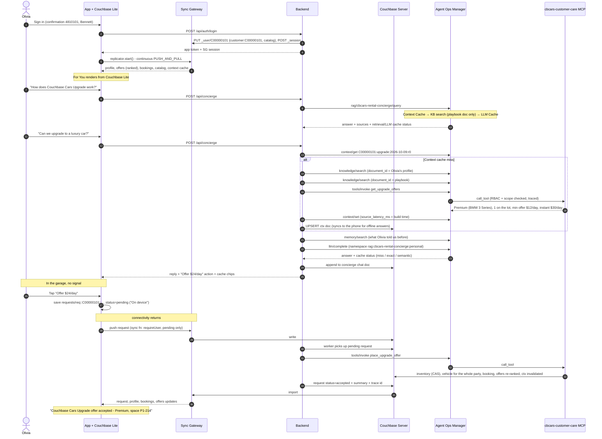
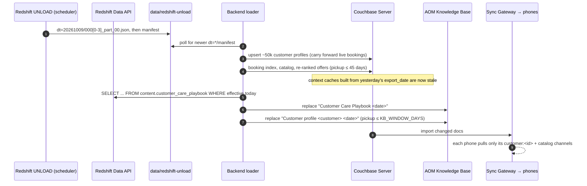
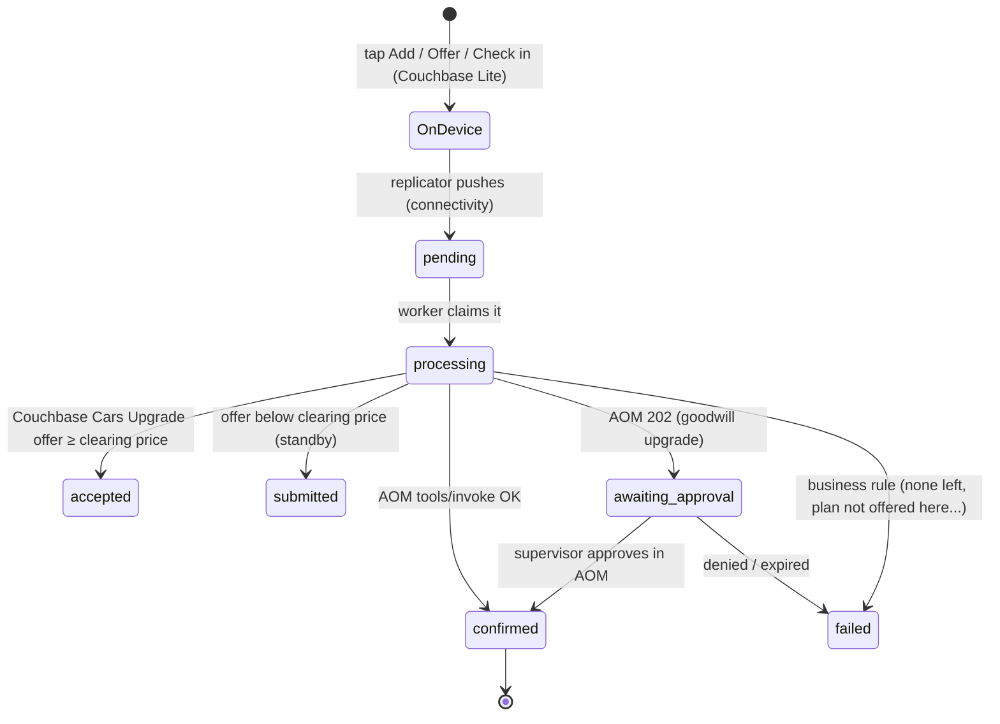

# Couchbase Cars · Mobile AI Personalization Demo

A customer-facing car-rental app that personalizes itself from the customer context Couchbase Cars keeps in **Amazon Redshift**: a **daily Redshift `UNLOAD`** of the customer 360 (identity, segments, Redshift ML propensity scores) for the data on the phone, the **Redshift Data API** for the customer's current segments and scores when the concierge builds context, and a **Redshift playbook table** for the Customer Care Playbook. It keeps working **in the airport garage with no signal** because the data lives on the phone in **Couchbase Lite**. Its concierge agent is **registered with, and governed by, the Couchbase Agent Operations Manager (AOM)**:

* answers are grounded in AOM's **Knowledge Base**
* it is registered as an AOM **RAG Application** (`cbcars-rental-concierge`), so its queries, cache hits and cost savings show on AOM's *RAG Applications* page
* the context it builds for each answer is cached in AOM's **Context Cache** and in Couchbase, which syncs it to the phone
* LLM calls go through AOM's **LLM Caching** gateway
* every change to the rental (vehicle upgrades, extras, protection, bundles, services, check-in) runs as an RBAC-checked, traced and audited AOM tool call, with human approval for complimentary upgrades

This is the car-rental sibling of the [Princess Cruises demo](https://github.com/Couchbase-Field-Engineering/princess-mobile-rag-personalization-demo): the same architecture, ported from cruises to rentals (locations instead of ships, car classes instead of stateroom categories, extras / protection / bundles / services instead of excursions / dining / packages / spa, a standby upgrade offer instead of an upgrade bid). The app's structure is based on [Fujio-Turner/mobile_field_service](https://github.com/Fujio-Turner/mobile_field_service): Expo / React Native, Couchbase Lite via `cbl-reactnative`, Sync Gateway session auth, and offline-first writes that sync when the radio comes back.

*Screenshots: run the stack and open `http://localhost:8081`.*

---

## How the demo opens

`http://<host>:8081/story` is **Personalization That Drives**, an eight-chapter story for the room before the live app, about cutting the LLM cost of an AI concierge with the Agent Operations Manager. Use ←/→ to move between chapters, **N** for talking points and ☾ for dark mode:

1. **The question costs money.** Live chat has hours and a queue; a naive LLM chatbot pays the model for every question; in the garage nothing answers at all. It closes with Olivia's two questions from the LAX parking structure, both answered from her phone.
2. **Where the LLM bill comes from.** Four cost drivers (repeat questions, context rebuilt every turn, unscoped retrieval, no answer offline) and the fix for each: AOM's LLM Cache, Context Cache, scoped RAG application, and cached context synced to Couchbase Lite.
3. **How it usually gets built.** Every box between the question and the answer is a bill. Press **Transform the stack**, or **T**.
4. **The same questions, two bills.** Five questions walked through an AOM-governed concierge and a plain chatbot, with a running LLM spend on each phone. Press **Next step**, or Space.
5. **One data plane for the AI.** Amazon Redshift (the daily unload, the live customer 360 and the playbook table) to Couchbase to the AOM Knowledge Base, RAG app and caches, and on to the phone, with live cache hit rates and model calls avoided from the running backend.
6. **Where the savings come from.** Question by question, with and without AOM.
7. **See it run.** Links to the app and the AOM dashboard, plus a five-minute script that ends with Confirm triggering the Vehicle Upgrade Agent and Agent Memory.

The phone frame's side panel links back to the story. The page is served by the `web` container (`web/story.html`). Its live numbers come from `/api/status`, which includes `metrics`: concierge turns, context-cache and LLM-cache hit rates, and requests that were queued offline and synced later. The AOM link uses `AOM_DASHBOARD_URL`.

## What the demo shows

| Concept | Where you see it |
|---|---|
| **Personalization from Amazon Redshift** | *For You* ranks upgrades, bundles, extras, protection and services per customer. The ranking uses the Redshift ML scores, segments and preferences from that morning's Redshift unload, the stops on the customer's trip plan, plus live inventory. The feed re-ranks after every booking. |
| **Couchbase Lite: offline and online** | Every screen renders from the on-device database. Turning on *Profile → In the garage - no signal* pauses replication. You can still browse, place a Couchbase Cars Upgrade standby offer or add a child seat: it's saved as a `requests` document marked **On device**, and when you turn the switch off it syncs and is confirmed. |
| **Registered with AOM** | `scripts/register_with_aom.py` sets up four things in AOM: the **Couchbase Cars Rental Concierge** agent identity (role `support_agent`, scoped to 11 tools), the **`cbcars-customer-care`** MCP server, the approval tier for goodwill upgrades, and the **`cbcars-rental-concierge` RAG Application**. |
| **AOM RAG Application** | Playbook questions ("How does Couchbase Cars Upgrade work?") go to `POST /v1/agent/rag/cbcars-rental-concierge/query`. AOM retrieves behind its Context Cache, generates behind its LLM Cache, and counts the query on the *RAG Applications* page. The app is scoped to the one *Customer Care Playbook* document, so a generic question can never retrieve another customer's profile. The loader re-scopes it to each day's new playbook. |
| **Knowledge Base fed by Amazon Redshift** | The loader publishes the *Customer Care Playbook*, rendered from the rows of the Redshift `content.customer_care_playbook` table (`redshift/playbook/`), plus one *Customer profile* document from the Redshift unload for each renter picking up soon. The concierge always searches with a `document_id` filter, so a customer's answer can only be grounded in **their own** profile. |
| **Context Caching** | For personal questions the concierge assembles context - the customer's **current customer-360 row from Amazon Redshift** (Redshift Data API: segment memberships and Redshift ML scores, a 120-350 ms round trip shown as an `Amazon Redshift · …ms` chip), their own KB profile chunks, playbook chunks and live tool facts - and caches it in **AOM's Context Cache** (`/v1/context/set`, namespace `rag:cbcars-rental-concierge:customer-context`, key `<customer>:<intent>:<export_date>:r<profile rev>`, with the real build time as `source_latency_ms`). The next question is a `/v1/context/get` hit, shown as a `Context cache · hit` chip and as latency avoided on AOM's *Context Cache* page. The next export or any booking by that customer changes the key, so the entry is never served stale. The same context is written to Couchbase as `ctx::<customer>::<intent>`, which syncs to the phone; that copy is what the offline concierge answers from. |
| **LLM Caching** | Every completion goes through AOM's LLM cache. Playbook questions contain no personal data, so the second customer to ask the same question gets `LLM cache · exact hit` from the RAG application. Personal questions go through `/v1/llm/complete` in the `rag:cbcars-rental-concierge:personal` namespace, which AOM also attributes to the RAG application. |
| **Governed actions** | Upgrades (Couchbase Cars Upgrade standby offer, instant, goodwill), extras, protection plans, bundles, services and Skip the Counter check-in all run as `POST /v1/tools/invoke`. AOM re-checks RBAC and the agent's tool scope, traces and audits the call, scans the response, and holds goodwill upgrades for a person to approve. |
| **Vehicle Upgrade Agent + Agent Memory** | **Confirm** on the upgrade screen creates a `purchase_vehicle_upgrade`, `place_upgrade_offer` or `apply_goodwill_upgrade` request. The worker hands those to a second AOM identity, the **Couchbase Cars Vehicle Upgrade Agent** (`backend/app/upgrade_agent.py`, scoped to the 5 upgrade tools). It first recalls the customer's vehicle history and preferences from **AOM Agent Memory** (`POST /v1/memory/search`), applies the upgrade as a governed tool call attributed to itself, then writes what happened back to memory (`POST /v1/memory`: from/to class and space, rental, what was paid or offered, the occasion). The request card shows *Run by the Vehicle Upgrade agent · Remembered in AOM Agent Memory*, and the concierge recalls the same memory on its next answer about cars. |

---

## Architecture



| # | Flow |
|---|---|
| **1** | Every morning the Redshift `UNLOAD` lands a `dt=YYYYMMDD` JSON Lines partition in S3 (synced to the landing folder), and the loader picks up the newest one whose `manifest` has been written. |
| **2** | The loader upserts every customer profile, re-ranks offers and publishes the catalog in Couchbase Server. The concierge reads and writes its **context cache** there, the worker reads pending requests, and the MCP tools apply bookings. |
| **3** | The loader replaces the AOM **Knowledge Base** documents (the Customer Care Playbook and one profile per renter picking up soon), then re-scopes the **RAG Application** to the new playbook. |
| **4** | Sign-in: the backend creates the customer's Sync Gateway user (channels `customer:<id>`, `catalog`) and mints a session. The concierge is called over `/api`. |
| **5** | **Couchbase Lite** replicates continuously with Sync Gateway. Every screen renders from the phone, and taps become `requests` documents saved locally, even offline. |
| **6** | Playbook questions go to the concierge's **RAG Application** in one call. Personal questions check AOM's **Context Cache**; on a miss the concierge does document-scoped **KB retrieval**, stores the context in AOM and Couchbase, recalls **memory**, then calls the **LLM Caching** gateway. |
| **7** | AOM calls the LLM provider only on a cache miss. |
| **8** | Sync Gateway carries requests up and results back down: the phone pushes its pending request, and the confirmed vehicle, booking and re-ranked offers come back. |
| **9** | The worker runs each request as the **Couchbase Cars Rental Concierge** agent through `POST /v1/tools/invoke`, so RBAC, tool scope, the approval tier, a trace and an audit entry are applied. |
| **10** | AOM calls the `cbcars-customer-care` MCP server, which applies the upgrade or booking in Couchbase, and that syncs back to the phone (2 → 8 → 5). |

### Upgrading a vehicle: the chatbot, the RAG application and the two AI buckets



The chatbot (Couchbase Cars Rental Concierge) and the RAG application are two different AOM callers with separate namespaces, budgets and cache hit rates. The `RAG_KB` bucket holds the Knowledge Base; the `AIDP` bucket holds AOM's Agent Memory, LLM and Context Caches, identities, traces and audit; the `cbcars` bucket is the system of record the upgrade is applied in. Steps 1-13 follow one customer from "Can we upgrade?" through **Confirm**, the Vehicle Upgrade Agent and Agent Memory; A-C show a playbook question answered once by the RAG application for every customer.

### A customer's workflow, end to end

Olivia (President's Club, anniversary road trip, Full-size at *Los Angeles Airport* in 9 days) signs in, asks the concierge about a luxury car, makes a Couchbase Cars Upgrade standby offer while she's offline in the garage, and the result syncs back when she reconnects:



A goodwill upgrade follows the same path. The difference is that AOM answers `202 pending_approval`: the request shows **Awaiting supervisor** on the phone until someone approves it on AOM's Approvals page. The worker then re-invokes with the `approval_id`.

### The daily data flow



### Offline-first request lifecycle



---

## Quick start

### 1. Browser preview in about 2 minutes (no Docker, no AOM)

The backend can run on an in-memory store, and the app has a browser preview engine that syncs the same documents over REST. Use this to look at the UX. Couchbase Lite needs a device build (step 3).

```bash
python3 redshift/generate_mock_unload.py               # ~100 MB export → data/redshift-unload/dt=<today>/
cd backend && python3 -m venv .venv && . .venv/bin/activate && pip install -r requirements.txt
uvicorn app.main:app --port 8200                    # STORE_DRIVER=memory by default
# new terminal
cd mobile && npm install && npx expo start --web    # sign in with a demo customer
```

### 2. Full stack: Couchbase, Sync Gateway and AOM

You need Docker Desktop, and the [Couchbase Agent Operations Manager](https://github.com/erikhinderer/couchbase-agent-operations-manager) running on the same machine at `https://localhost:8090`, with its admin password set.

```bash
cp .env.example .env
./scripts/setup-corporate-ca.sh            # only behind a TLS-inspecting proxy (Zscaler etc.)
docker compose up -d --build               # couchbase, init, sync-gateway, sg-init, backend, web
docker compose logs -f backend             # wait for "Loaded Redshift unload 2026-10-09: … rows"

python3 scripts/register_with_aom.py --admin-password '<AOM admin password>'
docker compose up -d --build backend       # picks up AOM_* from .env, publishes the KB, scopes the RAG app
```

`register_with_aom.py` is idempotent. Run it again with `--rotate` to issue a new agent key. After it runs, AOM shows:

* **Agents**: *Couchbase Cars Rental Concierge*, role `support_agent`, scoped to the 11 `cbcars-customer-care::*` tools, and *Couchbase Cars Vehicle Upgrade Agent*, scoped to the 5 upgrade tools (key written to `.env` as `AOM_UPGRADE_AGENT_API_KEY`)
* **Servers / Catalog**: `cbcars-customer-care` (trusted) and its tools
* **Knowledge**: *Customer Care Playbook <date>* and *Customer profile C… <date>* documents
* **Approvals config**: `cbcars-customer-care::apply_goodwill_upgrade` requires a human
* **RAG Applications**: *Couchbase Cars Rental Concierge (mobile)* (`cbcars-rental-concierge`), roles `support_agent` and `admin`, scoped to today's playbook document. Its activity counts playbook queries plus the concierge's personal LLM calls and context-cache lookups, all in `rag:cbcars-rental-concierge:*` namespaces
* **Context Cache**: entries in `rag:cbcars-rental-concierge:customer-context` (one per customer and intent) and `rag:cbcars-rental-concierge` (the RAG app's retrievals)

If the RAG application is created before the backend has published a playbook, it is registered **disabled**. The backend enables it and sets its document scope on its next load. `GET http://localhost:8200/api/status` shows its state under `aom.rag_app`.

Configure an LLM provider key in AOM to get generated answers. Without one, AOM returns a labelled stub: the backend then writes the answer itself from the same retrieved context, and AOM still reports the LLM-cache status (hit or miss).

Then open **http://localhost:8081/story** for the story that opens the demo, **http://localhost:8081** for the app in a browser, or **http://localhost:8200** for a page linking every service.

| Port | Service |
|---|---|
| `8081` | **The app in a browser** (`web` service), shown inside a phone frame (add `?frame=0` for full width): same screens and documents, synced over REST instead of Couchbase Lite |
| `8200` | Backend API + MCP server (`/cbcars/mcp`); `/` lists every link |
| `4984` | Sync Gateway public, which is what phones replicate with: `ws://<host>:4984/cbcars` |
| `127.0.0.1:4985` | Sync Gateway admin |
| `127.0.0.1:18091` | Couchbase Web Console (Administrator / password123) |

Ports are chosen so this stack runs alongside AOM (8090, 8091-8096). The Compose ports are the same as the Princess demo's, so run one of the two Compose stacks at a time (the Kubernetes values below give each demo its own ports).

### 3. The app on a device with Couchbase Lite

Couchbase Lite is a native module, so it needs a **development build**; Expo Go can't load it, the same as mobile_field_service. `npm install` runs `scripts/fetch-cbl-native.sh`, which fetches the `cbl-reactnative` native submodules that npm skips.

```bash
cd mobile
cp .env.example .env                       # API + Sync Gateway URLs (LAN IP for a physical phone)
npm install
npx expo run:ios -d "iPhone 16 Pro"        # or: npx expo run:android
npm run start:ios                          # later runs: Metro on localhost
```

The `web` service serves a prebuilt browser bundle (`web/dist.tgz`). After changing the app, rebuild it with `cd mobile && npm run export:web:docker`, then `docker compose up -d --build web`.

With `EXPO_PUBLIC_DB_ENGINE=auto`, the app uses Couchbase Lite whenever the native module is linked. *Profile → Offline & sync* shows the database path, the Sync Gateway endpoint, the replicator status and how many documents are waiting to send. The same notes as mobile_field_service apply: Xcode 26.4+ needs `plugin.fmt.js` (included), and there is a simulator keyboard toggle (⌘K).

### 4. Kubernetes with Helm (K3s / Rancher)

`deploy/k8s/deploy.sh` deploys AOM (**agent-ops**) and this demo (**cbcars-app**) onto a single-node K3s cluster, such as one managed by Rancher, without a container registry. Run it from your Mac, in this repository:

```bash
AOM_ADMIN_PASSWORD='<12+ characters>' ./deploy/k8s/deploy.sh      # MOTHER=ehind@192.168.111.4 by default
# mother already runs AOM, the Royal Caribbean demo (royal-app) and the Princess demo (princess-app): add this one next to them
AOM_ADMIN_PASSWORD='<current AOM password>' ONLY=cbcars ./deploy/k8s/deploy.sh
```

`deploy/k8s/values-mother.yaml` publishes this demo on **8083 / 8202 / 4987** so it can run alongside `royal-app` (8081 / 8200 / 4984) and `princess-app` (8082 / 8201 / 4986). The demos register with the same AOM under different ids (`cbcars-customer-care`, *Couchbase Cars Rental Concierge*, `cbcars-rental-concierge`), so they show up side by side on AOM's Agents, Servers and RAG Applications pages.

It runs four steps:

1. **Build.** It builds the three AOM images from `AOM_DIR` (default `~/github-couchbaselabs/couchbase-agent-operations-manager`) and this demo's `cbcars-backend` and `cbcars-web` images, for the node's CPU architecture.
2. **Import.** It copies the images over SSH and imports them into K3s's containerd. This asks for your sudo password on the node once.
3. **Install.** It runs `helm upgrade --install` on the node for both charts, and installs helm into `~/.local/bin` there if it's missing:
   * `aom` in namespace `agent-ops`, from AOM's own chart with `values-k3s.yaml`
   * `cbcars-app` in namespace `cbcars-app`, from [`helm/cbcars-app`](helm/cbcars-app) with [`deploy/k8s/values-mother.yaml`](deploy/k8s/values-mother.yaml)
4. **Secrets.** The AOM admin password and any `ANTHROPIC_API_KEY` / `OPENAI_API_KEY` / `GEMINI_API_KEY` go into mode-600 values files on the node, never onto a command line.

| Resource in `cbcars-app` | What it does |
|---|---|
| `couchbase` StatefulSet + `couchbase-init` hook Job | Couchbase Server EE 8.0.2. The Job runs the same `init.sh` as Compose |
| `sync-gateway` + `sg-init` hook Job | Sync Gateway 4.0.4. `sync-gateway-public` exposes 4984 for Couchbase Lite |
| `backend` | Loads the Redshift unload into Couchbase and serves the MCP server. Self-registers with AOM (`AOM_AUTO_REGISTER`, see below) |
| `redshift-unload` PVC | Holds the export. The backend's init container writes today's 100 MiB mock partition on first start |
| `redshift-daily-unload` CronJob | 05:00 America/New_York: writes a new partition (as the Amazon Redshift destination would) and keeps the newest 2. The backend picks it up within 5 minutes |
| `web` | The phone-framed app on 8083 (8081 in Compose). nginx proxies `/api` to the backend, so the browser needs only one URL |

**Self-registration.** No register script is needed in the cluster. With `AOM_AUTO_REGISTER=true`, the backend does the following on startup and retries until AOM is up:

* signs in to AOM. On a fresh AOM, it sets `AOM_ADMIN_PASSWORD` as the admin's first-login password
* registers `cbcars-customer-care` at `http://backend.cbcars-app.svc.cluster.local:8200/cbcars/mcp` (the in-cluster port; the published port is 8202)
* issues the *Couchbase Cars Rental Concierge* and *Couchbase Cars Vehicle Upgrade Agent* identities and keeps their keys in Couchbase
* turns on the approval tier
* publishes the Knowledge Base and the RAG application

Progress is in `/api/status` under `aom.registration`.

| URL on the node (192.168.111.4) | |
|---|---|
| `https://45.52.200.223:4111` | AOM dashboard the demo registers with (`admin` / `AOM_ADMIN_PASSWORD`; set in `values-mother.yaml`, the in-cluster AOM on `:3111` is the alternative) |
| `http://…:8083/story` | The story: start here |
| `http://…:8083` | The app |
| `http://…:8202/api/status` | Backend status |
| `ws://…:4987/cbcars` | Sync Gateway for Couchbase Lite (point a device build's `EXPO_PUBLIC_SG_URL` here, and `EXPO_PUBLIC_API_URL` at `:8202`) |

Ports are published by K3s's built-in ServiceLB. If a Service stays `<pending>`, either ServiceLB is disabled or the port is already taken on the node. In that case, set that Service's `type: NodePort` in `values-mother.yaml`. Redeploy just one side with `ONLY=aom` or `ONLY=cbcars`.

---

**Deploying on the node itself from GitHub.** A node that can reach GitHub can deploy without a workstation: `deploy/k8s/deploy-on-mother.sh` clones or fast-forwards the repo into `~/cbcars-deploy/src` (and, with `ONLY=aom`, the AOM repo into `~/cbcars-deploy/aom-src`), builds the images there with Docker, imports them into K3s and runs the Helm install - `deploy.sh` with `MOTHER=local`.

```bash
# first time, on mother
curl -fsSL https://raw.githubusercontent.com/Couchbase-Field-Engineering/couchbase-cars-mobile-ai-personalization-demo/main/deploy/k8s/deploy-on-mother.sh \
  | AOM_ADMIN_PASSWORD='<AOM admin password>' bash
# afterwards
AOM_ADMIN_PASSWORD='<AOM admin password>' ~/cbcars-deploy/src/deploy/k8s/deploy-on-mother.sh
```

`BRANCH`, `FORCE_DUMP=true`, `SKIP_BUILD=1 TAG=<tag>` and `ONLY` work as for `deploy.sh`. The node needs git, Docker with buildx, and sudo for `k3s ctr images import`.

## Demo script (about 10 minutes)

1. **Olivia Bennett** (President's Club, anniversary road trip, *Los Angeles Airport*, Full-size, 9 days out, 7 Day Pacific Coast Highway Road Trip)
   * *For You*: check-in first, then **Upgrade to a Premium** ("Only 1 left · Perfect for your anniversary"), then Zero Deductible Premium Protection and hotel delivery. Point out the footnote: the scores come from Redshift ML via Amazon Redshift and the data lives in Couchbase Lite.
   * *Concierge*: "Can we upgrade to a luxury car?" shows `Context cache · built` and `LLM cache · miss`. Ask it again: `Context cache · hit` and `LLM cache · exact hit`. Open **sources**: Olivia's KB profile and the playbook.
   * *Profile → In the garage - no signal* **on**. Place a Couchbase Cars Upgrade standby offer (**On device**), then ask "What's included in Couchbase Cars Total Protection?" (**Answered on device · Couchbase Lite**). Switch it **off**: the offer syncs and comes back **Accepted - Premium**. In AOM, show the trace and audit entry for `cbcars-customer-care::place_upgrade_offer`.
   * "The car smells of smoke and the AC is broken" offers **Request complimentary upgrade**, which shows **Awaiting supervisor**. Approve it in AOM → *Approvals*, and the phone flips to **Confirmed**.
2. **Priya Natarajan** (Preferred Plus, solo business traveler who prefers EVs, *San Francisco Airport*, Premium, picks up in 2 days): asks "How does Couchbase Cars Upgrade work?" and gets an **LLM cache exact hit** from Olivia's earlier question, because the playbook namespace is shared and has no personal data. Her feed leads with EV charging and the Wi-Fi hotspot.
3. **Carlos Rivera** (Preferred, family of four, *Orlando Airport*, 3 Day Orlando Family Getaway, Intermediate): the feed leads with child seats, e-Toll Unlimited and a Standard SUV upgrade. Adding a toddler seat is priced for the 3-day rental, and Zero Deductible Premium Protection is correctly refused because it isn't offered at Orlando Airport.

## Fleet chatbot workload: LLM Caching and Context Caching under load

Three personas show *how* the caches work; the fleet workload shows what they do to a real queue. `POST /api/demo/workload` (the **Run fleet workload** button on the story page, or the script below) plays customers from all 17 Couchbase Cars airport locations against the concierge, through the same path the phone uses: AOM RAG Application for playbook questions, AOM Context Cache + Knowledge Base + governed MCP tools for personal ones, AOM Agent Memory for what customers say about themselves, and `/v1/llm/complete` in the `rag:cbcars-rental-concierge:*` namespaces. Nothing is simulated on the AOM side - the point is to fill AOM's **LLM Cache**, **Context Cache**, **RAG Applications** and **Traces** pages with production-shaped traffic.

```bash
# against the deployment on mother (backend :8202, AOM dashboard https://192.168.111.4:3111)
python scripts/run_chatbot_workload.py
# bigger, faster, or a few locations
python scripts/run_chatbot_workload.py --customers-per-location 6 --turns 8 --concurrency 8 --locations LAX,SFO,MCO
python scripts/run_chatbot_workload.py --plan      # who asks what, without running
python scripts/run_chatbot_workload.py --stop
```

What a renter asks (`backend/app/workload.py`, `USE_CASES`): check-in, pickup times, documents, the Preferred Row, luggage and returns; upgrades and Premium / Luxury perks; extras, child seats, cancellations; protection, LDW, roadside, young drivers; Total Protection / Peace of Mind, fuel, Wi-Fi, tolls; services, EVs; the trip plan and return times; kids, fees, smoking, mileage, one-way rentals, payment, accidents, accessibility, Couchbase Cars Preferred; and a car that smells of smoke (service recovery, behind the approval tier). The traffic is shaped the way a support queue is:

* **Playbook questions** are drawn Zipf-style, so a few dominate. Most customers use the canonical wording (**exact hits** after the first customer pays for the answer), `--paraphrase-ratio` of them reword it (**semantic hits**), the long tail misses.
* **Personal questions** build a per-customer, per-intent context once (`Context cache: built`); the follow-up in the same intent reuses it (**hit**); `--repeat-ratio` of customers ask the same thing again (**exact LLM hit**, same prompt).
* **Statements** ("we need two child seats") go to Agent Memory and are recalled on that customer's later turns.

**Run for 24 hours.** `duration_hours` (the story page's **Run for 24 hours** button: 300 customers per location, 4 concurrent sessions; or `--hours 24` on the script) paces the run over that long instead of as fast as it can, following a day/night traffic curve (quiet overnight, morning ramp as flights land, peak in the evening), so AOM's charts look like a real customer-care queue. The run lives in the backend process: the script can be detached with Ctrl-C and the run continues; `--status` shows progress and `--stop` ends it. A backend restart ends the run.

The run reports per location, per use case and per cache outcome (`GET /api/demo/workload`), and the story page shows it live. Customers are picked from the loaded export among those picking up within `--window-days` (default 45), lead customers first, so every location in the catalog gets renters.

## Reset the demo

`POST /api/demo/reset` (the **Reset demo** button on the story page, or `python scripts/reset_demo.py`) puts the demo back to the state of today's unload. For the three personas plus every customer who changed something since the load (or `--customers C00000201`): their `requests`, chat and cached context are deleted, their profile is reloaded from the unload partition (vehicle, check-in, purchases, `rev` 0), the reserved cars of their pickup day are released, their offers re-ranked, and they are dropped from `live_customers`. Sync Gateway replicates the deletes and the fresh profile to the phone. In AOM, their Agent Memory entries are deleted and the concierge's cache namespaces (`rag:cbcars-rental-concierge*`, including the RAG application's own) are purged, so the next demo starts with a visible `miss` again; traces, audit log and approvals history are left alone. `--keep-aom-memory` / `--keep-aom-caches` / `--keep-counters` narrow it.

---

## The Amazon Redshift unload

`redshift/generate_mock_unload.py` writes the layout the Redshift `UNLOAD ... FORMAT AS JSON MANIFEST` job delivers (`redshift/unload/unload.sql`): JSON Lines part files (`0000_part_00.json`, ...) under `dt=YYYYMMDD/` and a `manifest` listing them (written last, so it is the completion marker) with an `unload` block: row count, source view, Redshift ML model version.

```bash
python3 redshift/generate_mock_unload.py --export-date 2026-10-09 --target-mb 100 --parts 4
```

* **About 50,000 customer rows** (about 20,000 reservations) over the 17 airport locations (LAX, SFO, JFK, MCO, DFW, ORD, ATL, DEN, MIA, SEA, BOS, LAS, PHX, IAH, EWR, SAN, FLL) and 150 days of pickups, 100 MiB, deterministic for a given `--seed` on a given Python version. Each part is about 25 MB, under GitHub's 50 MB warning.
* One line is **one customer on one upcoming reservation**: the resolved `identity` (customer id, CRM id, Wizard number, from the customer 360 identity graph), Couchbase Cars Preferred tier and points, the reservation (location, trip plan with daily stops, vehicle and space, party, check-in status, fuel option), preferences (interests, driving needs, fuel type, vehicle preference), up to 12 past rentals, ancillary-spend mix, what's already added to this rental, the **`segments`** the profile qualifies for (Upgrade propensity - high, Celebrating on the road, Convenience seekers, Families with children, ...) and **`ml_scores`** from Redshift ML (`redshift-ml-propensity-v2`).
* `ml_scores` holds the propensities (upgrade, prepaid fuel, protection, extras, services, Wi-Fi, tolls, Total Protection), price sensitivity, segment, next best action, recommended upgrade class and suggested Couchbase Cars Upgrade standby offer per day.
* Three hand-built **demo personas**, with pickups relative to the unload date, are always the first rows, followed by one near-term reservation per location so the fleet workload always covers all 17.
* `redshift/unload/README.md` describes the two production integrations: the scheduled `UNLOAD` (05:00 America/New_York, after the segmentation and Redshift ML scoring jobs; `unload.sql`) and the Redshift Data API the concierge calls for the customer's current row when it builds context. `redshift/playbook/` holds the playbook table's DDL (`schema.sql`) and seed rows (`seed.sql`).

The loader only needs a folder with a newer `dt=*/manifest` to appear: sync the UNLOAD's S3 prefix (`aws s3 sync`) into the backend container's `/data/redshift-unload`.

## Data model

Bucket `cbcars`, scope `rental`. Sync Gateway replicates the first seven collections to Couchbase Lite (same scope and collection names on the phone). A customer's SG user only gets the `customer:<id>` and `catalog` channels.

| Collection | Document | Written by | Notes |
|---|---|---|---|
| `profiles` | `profile::<customer>` | loader, actions | The Amazon Redshift profile row (+ `identity`, `segments`) + `rev` (bumped on every booking) |
| `offers` | `offers::<customer>` | personalization | Ranked *For You*, including upgrade options and the protection plans this location offers, for offline use |
| `bookings` | `bookings::<customer>` | actions | Confirmed items shown day by day |
| `requests` | `req::<customer>::<uuid>` | **the phone** (create), worker (status) | Offline-first queue. The sync function allows `requireUser(customer_id)`, `status: pending` and creation only |
| `concierge` | `chat::<customer>` | concierge | History + answers reusable offline |
| `context_cache` | `ctx::<customer>::<intent>` | concierge | Phone copy of the **Context Cache** entry also held in AOM: KB chunks + tool facts, `export_date`, `profile_rev`, TTL 6h |
| `catalog` | `catalog::v1` | loader | Locations, stops, trip plans, car classes, extras, protection, bundles, services, FAQ |
| `inventory` | `inv::<rental>` | actions | Unreserved cars per class per location and pickup day (CAS updates). Server only |
| `lookups` | `booking::…`, `kbdoc::…`, `load_state` | loader | Login index, KB document ids, load status. Server only |

The tools on the `cbcars-customer-care` MCP server are `get_customer_context`, `get_upgrade_offers`, `place_upgrade_offer`, `purchase_vehicle_upgrade`, `apply_goodwill_upgrade` (approval required), `search_rental_extras`, `add_rental_extra`, `select_protection_plan`, `add_bundle`, `book_rental_service` and `complete_mobile_checkin`.

### The rental catalog (`backend/app/catalog.py`)

| | |
|---|---|
| **Locations** | 17 US airport locations; each has garage lots (Preferred Row, Garage P1-P3, Premium Row, EV Row, SUV Row) a reserved car is parked in |
| **Trip plans** | 18 road-trip plans with one stop per day (`PU` pickup, `DRV` driving day, `RT` return), e.g. *7 Day Pacific Coast Highway Road Trip*, *3 Day Orlando Family Getaway*, *7 Day Southwest National Parks*. Stops carry interest tags that feed the ranking |
| **Car classes** | Economy → Compact → Intermediate → Full-size → Standard SUV → Premium → Luxury, the upgrade ladder, with per-day rates and example models |
| **Couchbase Cars Upgrade** | A standby offer per day (minimum by number of class steps), accepted at pickup when the class is on the lot; instant upgrades at ~82% of the rate difference; goodwill upgrades behind AOM's approval tier |
| **Extras** | Child seats, GPS, additional driver, satellite radio, roof box, bike / ski racks, snow chains, national parks pass (only when the plan visits a park), camping, beach and golf kits, EV charging credit, dash cam, pet kit, hand controls |
| **Protection** | LDW, PAI, PEC, ALI, Roadside SafetyNet, Tire & Windshield, EV cable & battery, Zero Deductible Premium (some only at certain locations) |
| **Bundles** | Couchbase Cars Peace of Mind, e-Toll Unlimited, Couchbase Cars Wi-Fi hotspot, Couchbase Cars Total Protection, Prepaid Fuel |
| **Services** | Hotel delivery and collection, mid-trip swap & wash, mobile refuel, mobile EV charging, late return - 20% off on mid-rental days |
| **Couchbase Cars Preferred** | Member, Preferred, Preferred Plus, President's Club, Chairman's Club |

---

## Configuration

Backend variables go in `.env` (see `.env.example`); `docker-compose.yml` sets the infrastructure ones.

| Variable | Default | |
|---|---|---|
| `STORE_DRIVER` | `memory` (compose: `couchbase`) | `memory` keeps customers picking up within `MEMORY_WINDOW_DAYS` |
| `AOM_URL`, `AOM_AGENT_API_KEY` | — | Concierge agent identity, written by `register_with_aom.py` |
| `AOM_UPGRADE_AGENT_API_KEY` | — | Vehicle Upgrade Agent identity, written by `register_with_aom.py`; blank = upgrades run as the concierge |
| `AOM_ADMIN_USERNAME`, `AOM_ADMIN_PASSWORD` | — | Used only to publish KB documents |
| `AOM_LLM_PROVIDER`, `AOM_LLM_MODEL` | AOM default | Pin the model completions use |
| `KB_WINDOW_DAYS`, `KB_PROFILE_LIMIT` | `10`, `150` | Which renters get a KB profile each day |
| `CONTEXT_CACHE_TTL_SECONDS` | `21600` | Upper bound; the unload date and profile rev invalidate it sooner |
| `RAG_APP_ID` | `cbcars-rental-concierge` | AOM RAG Application id; `RAG_APP_ENABLED=false` skips it |
| `LLM_NAMESPACE_PERSONAL` / `_PLAYBOOK` | `rag:cbcars-rental-concierge:personal` / `:playbook` | Keep the `rag:<app_id>:` prefix so AOM attributes the activity to the app |
| `CONTEXT_NAMESPACE` | `rag:cbcars-rental-concierge:customer-context` | AOM Context Cache namespace for personal context |
| `DEMO_TODAY` | the unload's `export_date` | Keeps "9 days to pickup" stable whenever you demo |
| `REDSHIFT_UNLOAD_DIR`, `REDSHIFT_POLL_SECONDS` | `data/redshift-unload`, `600` | Where the Redshift unload lands and how often to look |
| `REDSHIFT_WORKGROUP` *or* `REDSHIFT_CLUSTER_ID`, `REDSHIFT_DATABASE`, `REDSHIFT_SECRET_ARN`, `AWS_REGION` | — | Redshift Data API for the live customer 360 and the playbook table (blank = mock mode from the unloaded profile, `REDSHIFT_MOCK_LATENCY_MS=120,350`; live mode needs `boto3`) |
| `REDSHIFT_CUSTOMER_VIEW`, `REDSHIFT_PLAYBOOK_TABLE` | `analytics.customer_360_current`, `content.customer_care_playbook` | What the Data API queries |
| `SG_PUBLIC_URL` | — | Replication URL handed to phones |

App variables (`mobile/.env`): `EXPO_PUBLIC_API_URL`, `EXPO_PUBLIC_SG_URL`, `EXPO_PUBLIC_DB_ENGINE` (`auto` · `cbl` · `preview`).

---

## Tests

```bash
cd backend && pytest -q          # 24 tests
cd mobile && npm run typecheck
```

`test_demo_flows.py` covers personalization, the context cache (hit, then invalidation after a booking), the offline request flow, business-rule failures (a protection plan the location doesn't offer, a parks pass without a park on the plan), protection availability, and push authorization. `test_aom_integration.py` runs the backend against `tests/fake_aom.py`, which has the same routes and shapes as AOM. It checks KB publishing, document-scoped retrieval, RAG application registration and its playbook-only scope, personal context cached through AOM's Context Cache, the LLM cache shared across customers for playbook questions but not personal ones, tool calls over real MCP, and the approval tier, and runs the fleet workload through it (exact hits across customers, context hits on follow-ups). `test_workload.py` checks the workload's fleet coverage, plan and report in memory mode; `test_reset.py` checks the demo reset restores a persona after an upgrade. `test_aom_bootstrap.py` starts the backend with `AOM_AUTO_REGISTER` against a *fresh* fake AOM and checks that it registers itself end to end.

---

## Repository layout

```
backend/            FastAPI API, MCP server, loader, worker, concierge (Python)
  app/catalog.py        locations, trip plans, car classes, extras, protection, bundles, services (shared with the generator)
  app/personalization.py  For You ranking
  app/actions.py        upgrade / booking business logic behind every tool
  app/concierge.py      intent → AOM RAG app (playbook) | AOM Context Cache → KB + memory + LLM cache (personal) → actions
  app/workload.py       fleet chatbot workload: every location's customers × renter use cases → the concierge → AOM caches
  app/demo_reset.py     back to today's unload: customer docs, profile, inventory, offers; AOM memories and cache namespaces
  app/rag_app.py        the concierge's AOM RAG Application definition, re-scoped daily
  app/loader.py         daily Redshift unload → Couchbase + AOM Knowledge Base
  app/redshift.py       Redshift Data API clients: the live customer 360 (context) and the playbook table, mock or live
  app/worker.py         offline-first requests → AOM tools/invoke (upgrades → the upgrade agent)
  app/upgrade_agent.py  Vehicle Upgrade Agent: Agent Memory recall → governed upgrade → remember the outcome
  app/aom_bootstrap.py  self-registration with AOM (Kubernetes)
mobile/             Expo app (Couchbase Lite engine + browser preview engine)
redshift/           mock UNLOAD generator; unload/ the UNLOAD job, view and Data API notes; playbook/ playbook table DDL + seed
couchbase-init/     bucket / scope / collections / indexes
sync-gateway/       bootstrap + database config with per-collection sync functions
scripts/            register_with_aom.py, run_chatbot_workload.py, reset_demo.py, setup-corporate-ca.sh
web/                nginx image serving the browser build of the app on :8081 (proxies /api to the backend)
helm/cbcars-app/      Helm chart for the demo (Couchbase, Sync Gateway, backend, daily unload CronJob, web)
deploy/k8s/         deploy.sh + values for the K3s node "mother" (AOM and the demo)
data/               the Redshift unload landing folder
```

## Notes

* **Brand.** Couchbase Cars is a fictional rental brand. The look follows couchbase.com: Couchbase red `#EC1218`, black, white, peach `#FFF0DA` and orange `#FC9D0C`, Inter for type (standing in for the site's licensed Centra No2 headline face), and the Couchbase mark from the site header (`docs/images/couchbase-mark.svg`). Customers, locations, products and prices are invented.
* **Couchbase licensing.** Couchbase Server EE and Sync Gateway EE images run under the free developer license for dev and test. Shipping Couchbase Lite with encryption requires an Enterprise license, the same as mobile_field_service.
* **Credits.** `plugin.config.js`, `plugin.fmt.js`, `metro.config.js` and the two `mobile/scripts` come from [mobile_field_service](https://github.com/Fujio-Turner/mobile_field_service) (Apache-2.0).
